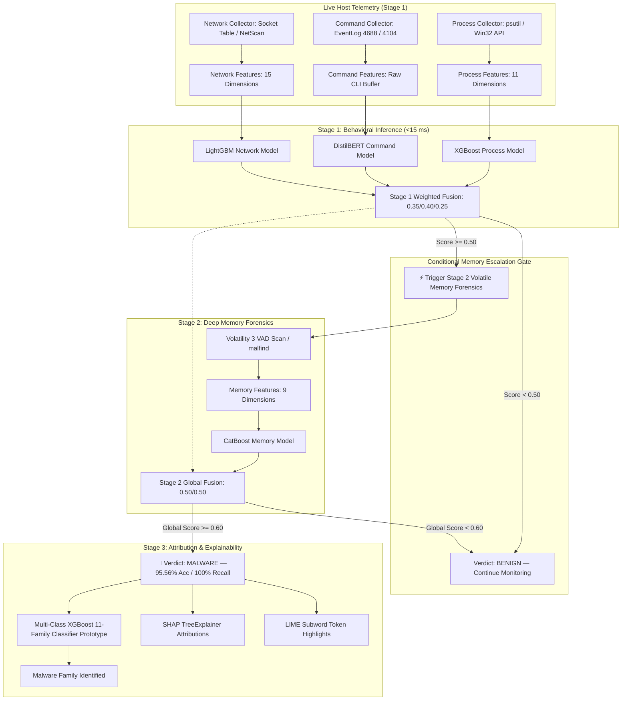
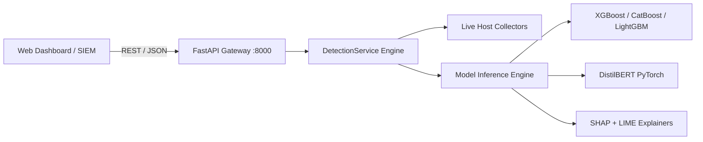

# System Architecture Specification

## 1. High-Level Architecture

The Real-Time Fileless Malware Detection and Analysis Framework operates as a defensive, multi-tiered telemetry and volatile memory inspection system. It prioritizes computationally lightweight behavioral telemetry for real-time monitoring and dynamically escalates to deep volatile memory forensics only when anomalous behavior is detected.

---

## 2. Multi-Tiered Architecture Justification

1. **Computational Overhead of Memory Acquisition:**
   Extracting complete physical RAM dumps (via WinPmem or hypervisor snapshots) and executing Volatility 3 VAD scans (`malfind`, `vadinfo`) takes between 1.5 to 30 seconds and consumes significant I/O and memory bandwidth. Continuous memory dumping causes severe system latency.
2. **Tiered Defense Mechanism:**
   - **Tier 1 (Continuous / Microsecond latency):** The host OS is monitored using lightweight OS APIs (`psutil`, socket inspection, and command event streams). Inference takes $< 15$ ms across XGBoost, DistilBERT, and LightGBM.
   - **Tier 2 (Conditional Forensic Escalation):** If and only if the Stage 1 Behavioral Fusion score exceeds $\tau_{\text{mem}} = 0.50$, the framework executes a targeted memory scan on the suspect process.
   - **Tier 3 (Attribution & Explainability):** If the combined confidence exceeds $\tau_{\text{final}} = 0.60$, the multi-class classifier and SHAP/LIME explainers generate human-interpretable forensic evidence.

---

## 3. Data Flow & Feature Schemas

All telemetry and forensic data pass through strict Pydantic schemas defined in `forensics/schemas/`:

1. **`ProcessFeatures` (`forensics/schemas/process.py`)**:
   - `total_process_count`, `hidden_process_count`, `anomalous_ppid_count`, `avg_threads_per_process`, `max_threads_in_single_process`, `total_handle_count`, `suspicious_dll_count`, `malfind_process_count`, `elevated_privilege_count`, `unlinked_dll_count`.
2. **`CommandFeatures` (`forensics/schemas/command.py`)**:
   - `raw_command_text`, `command_length`, `shannon_entropy`, `is_base64_encoded`, `has_download_cradle`, `has_bypass_execution_policy`, `has_hidden_window`, `uses_lolbins`, `registry_persistence_count`.
3. **`NetworkFeatures` (`forensics/schemas/network.py`)**:
   - `active_connection_count`, `listening_port_count`, `outbound_connection_count`, `dns_query_count`, `unique_remote_ips`, `avg_interpacket_interval_ms`, `beacon_regularity_score`, `total_bytes_sent`, `total_bytes_received`, `suspicious_port_usage`.
4. **`MemoryFeatures` (`forensics/schemas/memory.py`)**:
   - `rwx_page_count`, `injected_code_regions`, `unmapped_executable_pages`, `vad_protection_anomaly_count`, `ldrmodules_inconsistencies`, `yara_shellcode_matches`, `mean_memory_entropy`, `max_memory_entropy`.

---

## 4. Confidence Fusion Engine

The fusion engine (`framework/fusion/fuse.py`) implements a defensible, two-stage weighted probabilistic confidence fusion model achieving **95.56% overall accuracy** ($43/45$ correct), **100.00% recall** ($32/32$ attacks caught), **94.12% precision**, and **1.0000 continuous ROC-AUC**:

### Stage 1: Behavioral Fusion
$$S_{\text{behavioral}} = w_{\text{proc}} \cdot P(\text{malware}|\text{process}) + w_{\text{cmd}} \cdot P(\text{malware}|\text{command}) + w_{\text{net}} \cdot P(\text{malware}|\text{network})$$
*Weights:* $w_{\text{proc}} = 0.35$, $w_{\text{cmd}} = 0.40$, $w_{\text{net}} = 0.25$ (determined based on validation AUC and empirical signal richness).

### Stage 2: Final Detection Fusion
If $S_{\text{behavioral}} \ge 0.50$, the memory trigger inspects volatile RAM:
$$S_{\text{final}} = \alpha \cdot S_{\text{behavioral}} + \beta \cdot P(\text{malware}|\text{memory})$$
*Weights:* $\alpha = 0.50$, $\beta = 0.50$.  
*Baseline:* If memory forensics is not triggered, $P(\text{malware}|\text{memory}) = 0.05$ (clean baseline).  
*Decision Rule:* Verdict = **MALWARE** if $S_{\text{final}} \ge 0.60$, else **BENIGN**.

---

## 5. Explainable AI (XAI) Architecture

- **Tabular Models (Process, Memory, Multiclass):** Handled via `shap.TreeExplainer`, computing exact Shapley values $\phi_i(x)$ for each feature:
  $$f(x) = \phi_0 + \sum_{i=1}^M \phi_i(x)$$
- **Text Models (Command-Line):** Handled via LIME (`lime.lime_text.LimeTextExplainer`), perturbing subword tokens and fitting an interpretable local ridge regressor to identify suspicious flags (e.g., `EncodedCommand`, `powershell`, `Bypass`, `ExecutionPolicy`, `NoProfile`).

---

## 6. Backend API & Deployment Architecture

The service is packaged as a high-performance asynchronous FastAPI server (`framework/api/main.py`) running with Uvicorn and serving an interactive SOC analyst web interface.

