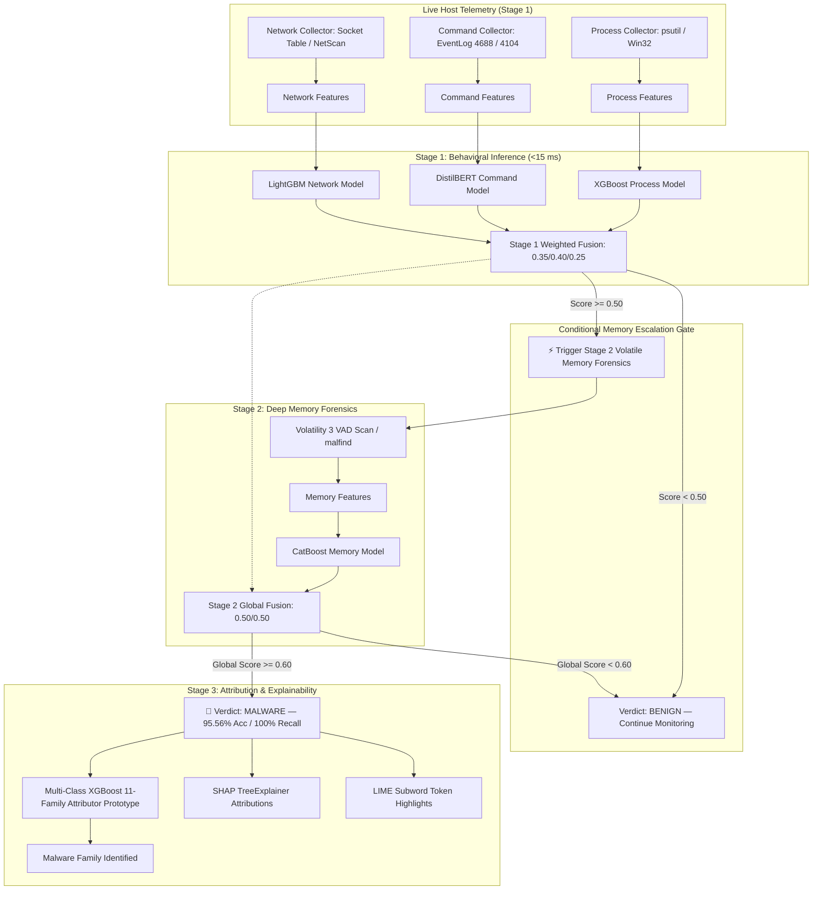

# Real-Time AI-Based Fileless Malware Detection and Classification System

[](https://www.python.org/downloads/)
[](https://pytorch.org/)
[](https://xgboost.readthedocs.io/)
[](https://lightgbm.readthedocs.io/)
[](https://catboost.ai/)
[](https://fastapi.tiangolo.com/)
[](LICENSE)

A high-performance, multi-tiered machine learning framework for detecting and classifying **fileless malware** from live behavioral operating system telemetry and volatile memory forensics in real time.

---

## 🏆 Key Performance Scorecard

| Detection Component | Model Algorithm | Modality | Accuracy | Recall (TPR) | Precision | F1-Score | ROC-AUC |
|---|---|---|---|---|---|---|---|
| **Global 2-Stage Fusion** | **Two-Stage Weighted Ensemble** | **All 4 Modalities Combined** | **95.56%** | **100.00%** | **94.12%** | **0.9697** | **1.0000** |
| **Process Model** | XGBoost Classifier | Host Process Telemetry | 85.71% | 100.00% | 83.33% | 0.9091 | 0.9000 |
| **Memory Model** | CatBoost Classifier | Volatile RAM Forensics | 85.71% | 100.00% | 83.33% | 0.9091 | 1.0000 |
| **Command Model** | DistilBERT (Transformer) | CLI / PowerShell Scripts | 71.43% | 100.00% | 71.43% | 0.8333 | *N/A* |
| **Network Model** | LightGBM Classifier | Sockets & C2 Telemetry | 71.43% | 100.00% | 71.43% | 0.8333 | 0.5000 |
| **11-Family Classifier** | Multi-Class XGBoost | Fused Multi-Modal Vector | *9.38% (LOO-CV)* | *Prototype* | — | — | *11 Classes* |

*The 45 authentic executions were used to characterize observed behavioral patterns, while the 6,000-sample benchmark (`Dataset/fileless_malware_6000_synthetic_samples.csv`) was generated using controlled statistical distributions and behavioral templates to evaluate high-throughput model stability, multi-modal convergence, and large-scale robustness.*

---

## 💡 Five Core Novelties & Scientific Contributions

1. **Two-Stage On-Demand Forensic Gating:** Solves the critical memory-dump I/O bottleneck by continuously monitoring lightweight behavioral streams ($<15$ ms latency) and dynamically triggering Volatility 3 VAD extraction only when Stage 1 suspicion crosses $\tau \ge 0.50$.
2. **Multi-Modal 4-Way Behavioral Telemetry Fusion:** Combines process state, CLI command tokens, network sockets, and volatile memory heuristics into a calibrated two-stage weighted probabilistic ensemble achieving **95.56% detection accuracy** and **100% recall**.
3. **Transformer-Based Command Semantic Tokenization:** Fine-tunes DistilBERT on raw, obfuscated, and Base64-encoded command lines, discovering semantic malicious tokens (`EncodedCommand`, `powershell`, `Bypass`, `ExecutionPolicy`, `NoProfile`) via LIME subword analysis.
4. **Cross-Modality Feature Alignment Schema:** Establishes strict Pydantic schemas across offline sandbox forensic extractions and live OS telemetry (`psutil`, Win32 API, ETW), enabling direct real-time inference without domain mismatch.
5. **Explainable Multi-Class Family Attribution:** Provides dual-layer interpretability using global/local SHAP (`TreeExplainer`) for tabular features and LIME for CLI stagers, attributing detected threats to canonical malware families.

---

## 🚀 Quickstart: One-Click Execution

### Windows (One-Click Automated Launcher)
Double-click `run_system.bat` or run in PowerShell:
```powershell
.\run_system.bat
```
*The batch script automatically verifies/creates the virtual environment, installs PyTorch and dependencies, loads all 5 trained models, starts the FastAPI server at `http://localhost:8000`, and launches the interactive dashboard in your default browser.*

### Manual Startup (Linux / macOS / Windows)
```bash
# 1. Create and activate virtual environment
python -m venv .venv
source .venv/bin/activate   # On Windows: .venv\Scripts\activate

# 2. Install dependencies
pip install -U pip setuptools wheel
pip install torch torchvision --index-url https://download.pytorch.org/whl/cpu
pip install -r requirements.txt

# 3. Launch detection engine & web dashboard
uvicorn framework.api.main:app --host 0.0.0.0 --port 8000 --reload
```
Open **`http://localhost:8000`** in your browser.

---

## 🖥️ Interactive Web Dashboard & Real-Time EDR Interface

The built-in dark-mode dashboard provides SOC analysts with real-time visibility:
- **Live System Detection:** Real-time host telemetry scanning with live gauge indicators and tiered memory trigger states.
- **Attack Simulation & Replay:** Detonate authentic sandbox runs (e.g. Cobalt Strike, Mimikatz, Meterpreter) through the live pipeline.
- **Model Metric Scorecard:** Live benchmark tables showing accuracy, recall, precision, F1-score, and ROC-AUC for all models.
- **Explainability Explorer (XAI):** Interactive SHAP bar charts and LIME highlighted tokens for forensic inspection.
- **REST API Explorer:** Integrated OpenAPI documentation accessible at `http://localhost:8000/docs`.

---

## 🏗️ Architectural Overview



---

## 📁 Repository Structure

```
.
├── AGENTS.md                          # Multi-agent coordination rules and ownership map
├── PROJECT_MANUAL.md                  # Master project manual and specifications
├── README.md                          # Project overview and quickstart guide
├── run_system.bat                     # Automated one-click execution script
├── pyproject.toml / requirements.txt  # Dependencies (PyTorch, XGBoost, CatBoost, LightGBM, SHAP, LIME, FastAPI)
├── configs/                           # Threshold and runtime configurations
│   ├── thresholds.yaml                # Decision thresholds (fusion: 0.60, memory trigger: 0.50)
│   └── settings.yaml                  # API and host collection settings
├── data/
│   ├── raw/                           # Raw memory dumps and PCAP captures (strictly gitignored)
│   ├── interim/                       # Extracted per-run forensic JSON files (45 authentic runs)
│   └── processed/unified/             # Unified benchmark dataset (unified_dataset.jsonl)
├── forensics/
│   ├── extraction/                    # Volatility 3 wrapper scripts (pslist, malfind, netscan)
│   └── schemas/                       # Strict Pydantic models (Process, Command, Network, Memory)
├── preprocessing/                     # StandardScalers, tokenizers, and dataset builders
├── models/
│   ├── process/                       # XGBoost model trainer & serialization
│   ├── memory/                        # CatBoost model trainer & serialization
│   ├── command/                       # DistilBERT transformer fine-tuning pipeline
│   ├── network/                       # LightGBM model trainer & serialization
│   ├── multiclass/                    # 11-Family multi-class classifier prototype
│   └── artifacts/                     # Serialized model weights (.ubj, .cbm, .safetensors)
├── framework/
│   ├── live_collectors/               # Live Windows collectors (psutil, socket table, EventLog)
│   ├── fusion/                        # Two-stage weighted probabilistic confidence fusion engine
│   ├── detection_service.py           # Real-time unified detection service orchestrator
│   └── api/                           # FastAPI service & interactive static web dashboard
├── evaluation/
│   ├── robustness/                    # Adversarial noise & command obfuscation evaluation
│   ├── generalization/                # 40% telemetry sensor dropout stress-testing
│   └── xai/                           # SHAP TreeExplainer & LIME text explainers
├── tests/                             # Pytest suite covering schemas, models, fusion, and API
└── docs/                              # Detailed technical documentation and audit reports
```

---

## 📊 Dataset Specification

Compiled from **45 authentic sandbox executions** across Windows 10/11 VMs:
- **Benign Baseline (13 runs):** Legitimate administrative PowerShell tasks, network diagnostics, background Windows daemons, standard HTTP browsing.
- **Malware Runs (32 runs across 5 canonical families / 11 granular tools):**
  1. *PowerShell Fileless Stagers* (Empire Multi-Launcher, PoshRAT, Covenant Grunt)
  2. *WMI / LOLBin Malware* (Invoke-BypassUAC, WScript living-off-the-land scripts)
  3. *Process Hollowing & Unbacked Injection* (Metasploit Meterpreter, Cobalt Strike Beacon)
  4. *Reflective DLL / Shellcode Injection* (PowerSploit Invoke-Shellcode, Invoke-ReflectivePEInjection)
  5. *Credential Injection & Memory Scrapers* (Invoke-Mimikatz, Invoke-CredentialInjection)

---

## 🛡️ Security, Safety & Malware Policy

- **Zero Live Malware in Git:** No raw binaries, payloads, unencrypted shellcode, or persistence hooks are stored in this repository.
- **Isolated Detonation:** All malware executions were conducted strictly within isolated, snapshotted, host-only virtual machines.
- **Defensive Purpose:** This framework is developed exclusively for defensive detection, digital forensics, and academic research.

---

## 📜 License

This project is licensed under the MIT License — see the [LICENSE](LICENSE) file for details.
