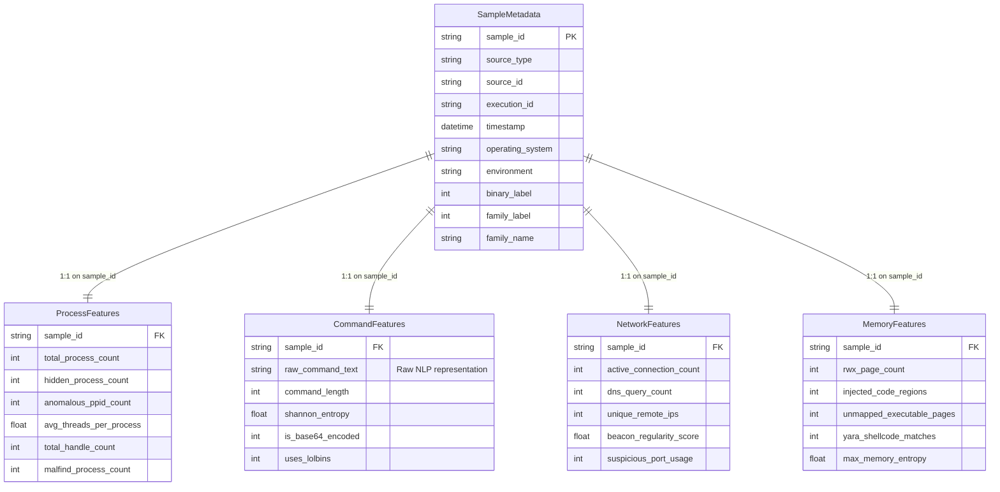

# DATA SCHEMA & LABELING CONVENTION (Task J2)

This document specifies the **Joint Data Contract** between **Track A (Core Detection Engine)** and **Track B (Modeling, Language Signals & Assurance)** for the Real-time AI-based Fileless Malware Detection and Classification System.

---

## 1. Relational Architecture & Identity Model

Every forensic acquisition or live evaluation session revolves around a single canonical identifier: **`sample_id`**.



### Conceptual Identity Example
For an execution identified as `sample_id = EXEC_20260913_001`:
```
EXEC_20260913_001
├── SampleMetadata   -> { OS: Windows 11, Source: Custom Sandbox, Label: Malware, Family: Process Hollowing }
├── ProcessFeatures  -> { total_process_count: 142, hidden_process_count: 1, malfind_process_count: 1, ... }
├── CommandFeatures  -> { raw_command_text: "powershell -ep bypass...", is_base64_encoded: 1, uses_lolbins: 1, ... }
├── NetworkFeatures  -> { active_connection_count: 8, beacon_regularity_score: 0.92, suspicious_port_usage: 1, ... }
└── MemoryFeatures   -> { rwx_page_count: 3, injected_code_regions: 2, yara_shellcode_matches: 1, ... }
```

---

## 2. Standardized Labels

### 2.1 Binary Detection Label (Objective 2)
Used by the four independent binary detectors (Process XGBoost, Memory CatBoost, Command DistilBERT, Network LightGBM) and the confidence fusion engine.

| Code | Label Name | Description |
|---|---|---|
| `0` | **Benign** | Standard administrative, background OS, or safe user activity. |
| `1` | **Malware** | Fileless malicious execution confirmed via memory forensics or suspicious telemetry. |

### 2.2 Multi-Class Family Label (Objective 3)
Used by the multi-class family classifier when Objective 2 returns a `Malware` verdict.

> [!IMPORTANT]
> **Initial Baseline Taxonomy vs. Final Collection**:
> The numeric mapping below is the **initial project mapping**. As specified in `PROJECT_MANUAL.md` §4.8, the final 4–5 malware families remain subject to the outcome of Phase 1 sandbox and public dataset collection. The schema is designed to allow updating family designations without invalidating data contracts.

| Code | Family Name (Initial Baseline) | Responsible Track | Key Indicators |
|---|---|---|---|
| `0` | **Benign** | Joint | Normal process trees, standard signed modules, clean memory regions |
| `1` | **PowerShell Fileless** | Track A / B | Base64 execution, download cradles, memory-only script execution |
| `2` | **WMI Malware** | Track B | WMI event filters/consumers, CommandLineEventConsumer persistence |
| `3` | **Process Hollowing** | Track A | Unmapped PE headers in benign host process, malfind anomalies |
| `4` | **Reflective DLL Injection** | Track B / A | Unlinked DLL in LdrModules, manual relocations in heap/private pages |
| `5` | **Registry Malware** | Track A / B | Large hex/payload blobs stored in registry keys executed via LOLBins |

---

## 3. Schema Contracts & Field Catalog

### 3.1 Metadata (`data/schemas/sample_metadata.schema.json`)
Tracks provenance, runtime environment, and ground truth labels.

| Field Name | Type | Req/Opt | Source | Nature | Missing Policy |
|---|---|---|---|---|---|
| `sample_id` | `string` | Required | System UUID / Dataset ID | Static | Must exist |
| `source_type` | `enum` | Required | Sandbox harness or public source | Static | Must exist |
| `source_id` | `string` | Required | SHA-256 hash or original row ID | Static | Must exist |
| `execution_id` | `string` | Required | Sandbox session identifier | Static | Must exist |
| `timestamp` | `datetime` | Required | System clock at acquisition | Static | Must exist |
| `operating_system` | `enum` | Required | Guest OS environment | Static | Must exist |
| `environment` | `enum` | Required | Hypervisor (VMware, VBox, etc.) | Static | Must exist |
| `binary_label` | `integer` | Required | Ground truth (0 or 1) | Static | Must exist |
| `family_label` | `integer` | Required | Multi-class label integer | Static | Must exist |
| `family_name` | `string` | Required | Canonical family name | Static | Must exist |

---

### 3.2 Process Features (`data/schemas/process_features.schema.json`)
- **Owner**: Track A
- **Model**: XGBoost (`models/process/`)
- **Offline Extractors**: Volatility3 `windows.pslist`, `windows.psscan`, `windows.pstree`, `windows.threads`, `windows.handles`, `windows.dlllist`, `windows.malfind`, `windows.psxview`, `windows.privileges`.
- **Live Collector**: `framework/live_collectors/process_collector.py` (`psutil` + Sysmon Event ID 1).

| Field Name | Type | Req/Opt | Source | Nature | Missing Policy |
|---|---|---|---|---|---|
| `sample_id` | `string` | Required | Sample foreign key | Static | Must exist |
| `total_process_count` | `integer` | Required | `pslist` / `psutil.pids()` | Dynamic | `impute_median` |
| `hidden_process_count` | `integer` | Required | `psscan`, `psxview` cross-ref | Dynamic | `fill_zero` |
| `anomalous_ppid_count` | `integer` | Required | `pstree` / Sysmon EID 1 | Dynamic | `fill_zero` |
| `avg_threads_per_process` | `number` | Required | `threads` / `psutil` | Dynamic | `impute_median` |
| `max_threads_in_single_process`| `integer` | Required | `threads` / `psutil` | Dynamic | `impute_median` |
| `total_handle_count` | `integer` | Required | `handles` / `psutil` | Dynamic | `impute_median` |
| `suspicious_dll_count` | `integer` | Required | `dlllist` / Sysmon EID 7 | Dynamic | `fill_zero` |
| `malfind_process_count` | `integer` | Required | `malfind` injection hits | Dynamic | `fill_zero` |
| `elevated_privilege_count` | `integer` | Required | `privileges` token audit | Dynamic | `fill_zero` |
| `unlinked_dll_count` | `integer` | Optional | `ldrmodules` cross-check | Dynamic | `fill_zero` |

---

### 3.3 Command Features (`data/schemas/command_features.schema.json`)
- **Owner**: Track B
- **Model**: DistilBERT fine-tuning / RoBERTa (`models/command/`)
- **Offline Extractors**: Volatility3 `windows.cmdline`, `windows.registry`, PowerShell Transcript / ScriptBlock (EID 4104), Sysmon EID 1, Bash history.
- **Live Collector**: `framework/live_collectors/command_collector.py` (ScriptBlock logging + Sysmon stream).

> [!NOTE]
> `raw_command_text` is the **raw NLP input representation** for sequence tokenization and embedding. The remaining fields represent structured, derived metrics for feature analysis and tree-based baselines.

| Field Name | Type | Req/Opt | Source | Nature | Missing Policy |
|---|---|---|---|---|---|
| `sample_id` | `string` | Required | Sample foreign key | Static | Must exist |
| `raw_command_text` | `string` | Required | `windows.cmdline` / EID 4104 | Dynamic (NLP) | `fill_empty_string` |
| `command_length` | `integer` | Required | Length of raw text | Dynamic (Metric)| `fill_zero` |
| `shannon_entropy` | `number` | Required | Calculated Shannon entropy | Dynamic (Metric)| `impute_median` |
| `is_base64_encoded` | `integer` | Required | Regex match (`-enc`, b64 pattern)| Dynamic (Metric)| `fill_zero` |
| `has_download_cradle` | `integer` | Required | Pattern match (WebClient, IWR) | Dynamic (Metric)| `fill_zero` |
| `has_bypass_execution_policy`| `integer` | Required | `-ExecutionPolicy Bypass` | Dynamic (Metric)| `fill_zero` |
| `has_hidden_window` | `integer` | Required | `-WindowStyle Hidden` | Dynamic (Metric)| `fill_zero` |
| `uses_lolbins` | `integer` | Required | Certutil, mshta, wmic match | Dynamic (Metric)| `fill_zero` |
| `registry_persistence_count` | `integer` | Optional | `registry.printkey` / EID 12,13 | Dynamic (Metric)| `fill_zero` |

---

### 3.4 Network Features (`data/schemas/network_features.schema.json`)
- **Owner**: Track B
- **Model**: LightGBM (`models/network/`)
- **Offline Extractors**: Volatility3 `windows.netscan`/`netstat` cross-referenced with `tshark` `.pcap` capture.
- **Live Collector**: `framework/live_collectors/network_collector.py` (`scapy` / `pyshark`).

| Field Name | Type | Req/Opt | Source | Nature | Missing Policy |
|---|---|---|---|---|---|
| `sample_id` | `string` | Required | Sample foreign key | Static | Must exist |
| `active_connection_count` | `integer` | Required | `netscan` / socket table | Dynamic | `fill_zero` |
| `listening_port_count` | `integer` | Required | `netscan` listening ports | Dynamic | `fill_zero` |
| `outbound_connection_count`| `integer` | Required | Non-loopback external sockets | Dynamic | `fill_zero` |
| `dns_query_count` | `integer` | Required | `tshark` DNS query filter | Dynamic | `fill_zero` |
| `unique_remote_ips` | `integer` | Required | Distinct remote IP count | Dynamic | `fill_zero` |
| `avg_interpacket_interval_ms`| `number` | Required | `tshark` delta arrival times | Dynamic | `impute_median` |
| `beacon_regularity_score` | `number` | Required | Inter-arrival periodicity (0..1) | Dynamic | `fill_zero` |
| `total_bytes_sent` | `integer` | Required | Interface bytes transmitted | Dynamic | `fill_zero` |
| `total_bytes_received` | `integer` | Required | Interface bytes received | Dynamic | `fill_zero` |
| `suspicious_port_usage` | `integer` | Required | Reverse shell port match | Dynamic | `fill_zero` |

---

### 3.5 Memory Features (`data/schemas/memory_features.schema.json`)
- **Owner**: Track A
- **Model**: CatBoost (`models/memory/`)
- **Offline Extractors**: Volatility3 `windows.malfind`, `windows.vadinfo`, `windows.ldrmodules`, `windows.vadyarascan`, page entropy.
- **Live Collector**: `framework/live_collectors/memory_trigger.py` (triggered on suspicious process/command/network score -> partial working set acquisition).

| Field Name | Type | Req/Opt | Source | Nature | Missing Policy |
|---|---|---|---|---|---|
| `sample_id` | `string` | Required | Sample foreign key | Static | Must exist |
| `rwx_page_count` | `integer` | Required | `vadinfo` RWX protection | Dynamic | `fill_zero` |
| `injected_code_regions` | `integer` | Required | `malfind` unbacked code | Dynamic | `fill_zero` |
| `unmapped_executable_pages`| `integer` | Required | `vadinfo` private exec pages | Dynamic | `fill_zero` |
| `vad_protection_anomaly_count`|`integer`| Required | Protect vs InitProtect delta | Dynamic | `fill_zero` |
| `ldrmodules_inconsistencies`| `integer` | Required | `ldrmodules` 3-list comparison| Dynamic | `fill_zero` |
| `yara_shellcode_matches` | `integer` | Required | `vadyarascan` signature hits | Dynamic | `fill_zero` |
| `mean_memory_entropy` | `number` | Required | Executable page Shannon entropy| Dynamic | `impute_median` |
| `max_memory_entropy` | `number` | Required | Peak page Shannon entropy | Dynamic | `impute_median` |

---

## 4. Multi-Track Compatibility & Merge Rules

1. **Schema Immutability**: All four feature files and the metadata record must share the identical `sample_id`.
2. **Offline vs. Online Parity**: Any extractor script emitting an interim JSON file (`data/interim/<domain>/<sample_id>.json`) and any live collector emitting a dictionary for the detection API must validate against the exact same Pydantic schema in `forensics/schemas/`.
3. **Missing Value Imputation**: Missing values must follow the explicit policy defined in the schema contract before feeding models or concatenation in `preprocessing/pipeline.py`.
