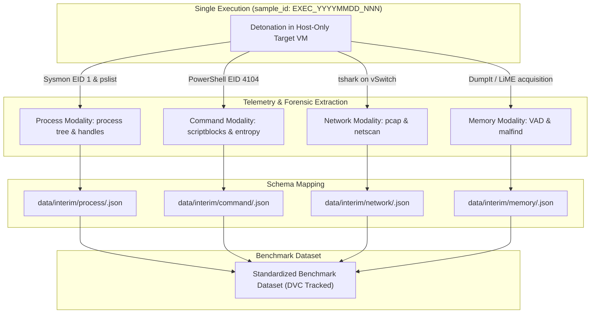

# Threat Analysis Environment Guide (Task A1)

This comprehensive guide describes the architecture, containment safeguards, and operational workflow for the isolated fileless malware analysis environment.

---

## 1. Threat Analysis Architecture

The framework relies on volatile memory and behavioral telemetry captured from real, controlled executions inside an isolated virtual testbed.

```
+-----------------------------------------------------------------------------------+
| PHYSICAL HOST SYSTEM (Workstation)                                                |
|                                                                                   |
|  +-----------------------------------------------------------------------------+  |
|  | HYPERVISOR VIRTUAL SWITCH: Host-Only Subnet 192.168.100.0/24                |  |
|  | [No Physical NIC Bridge]  [No NAT Egress]  [Promiscuous Sniffer Active]     |  |
|  +-----------------------------------------------------------------------------+  |
|          |                                                    |                   |
|          v                                                    v                   |
|  +------------------------------+             +--------------------------------+  |
|  | ATTACKER / C2 VM             |             | TARGET / VICTIM VM             |  |
|  | Kali Linux (192.168.100.10)  | <=========> | Windows 11/10 (192.168.100.20) |  |
|  | - Attack listener endpoint   |   Network   | - Telemetry: Sysmon + PS Logs  |  |
|  | - Controlled execution origin|   Traffic   | - Forensics: Memory Dump       |  |
|  +------------------------------+             +--------------------------------+  |
|                                                               |                   |
|                                                               v                   |
|                                               [ External Evidence Storage ]       |
|                                               - Memory dump (.raw)                |
|                                               - Network pcap (.pcap)              |
|                                               - Event logs (.evtx, .txt)          |
|                                               - Hashes (.sha256)                  |
+-----------------------------------------------------------------------------------+
```

---

## 2. Containment & Safety Guarantees

1. **Air-Gapped Virtual Network**:
   - Host-Only networking ensures that IP packets generated during malware execution cannot reach your physical LAN or the Internet.
   - NAT and Bridged adapters are strictly forbidden across all virtual machines.
2. **Hypervisor Isolation**:
   - Shared folders are disabled to eliminate the risk of guest-to-host file dropping or ransomware traversal.
   - Clipboard synchronization and drag-and-drop are disabled to prevent inadvertent copy-paste of malicious scripts or payloads onto the host machine.
3. **Execution State Volatility**:
   - Every run starts from a pristine baseline snapshot (`Clean_Baseline_v1`).
   - Immediately upon memory acquisition, the target VM is forcefully reverted to the clean baseline.
   - No persistent state survives between runs.

---

## 3. Four-Modality Telemetry Extraction

Every single execution session captures all four feature domains:



---

## 4. Operational Execution Runbook

When conducting execution runs during Phase 1:

1. **Pre-Flight Verification**:
   - Confirm virtual switch is Host-Only.
   - Start network capture on virtual switch: `tshark -i <vif> -w <EVIDENCE_ROOT>/<sample_id>/<sample_id>_network.pcap`.
2. **Execute Sample**:
   - Launch target technique from Attacker VM or internal staging script.
   - Observe behavior for 3–5 minutes.
3. **Forensic Acquisition**:
   - Run memory acquisition inside target VM (`DumpIt.exe`).
   - Stop network capture.
   - Export event logs (`Sysmon.evtx`, `PowerShell.evtx`, transcripts).
4. **Log Metadata**:
   - Append execution record to `sandbox/execution-logs/log.csv`:
     ```csv
     sample_id,family,vm,os,timestamp,operator,sample_sha256,notes
     ```
5. **Revert**:
   - Revert VM to clean baseline snapshot.
   - Verify pristine state before proceeding.
